# Class Activity 1 — System Calls in Practice

- **Student Name:** [LY SENGKIM]
- **Student ID:** e20231094
- **Date:** [6/11/2026]

---

## Warm-Up: Hello System Call

Screenshot of running `hello_syscall.c` on Linux:

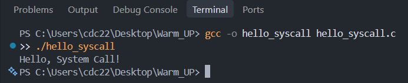

Screenshot of running `hello_winapi.c` on Windows (CMD/PowerShell/VS Code):

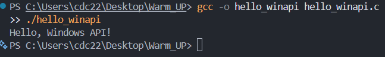

Screenshot of running `copyfilesyscall.c` on Linux:

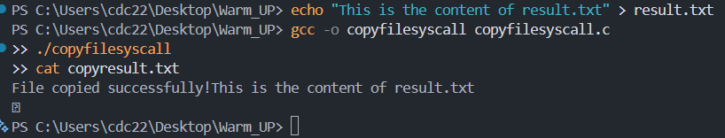

> Note: the handout passes `19` to `write()` for `"Hello, System Call!\n"`, but that string is **20** bytes (19 visible characters + the `\n`). I used 20 so the newline is printed. The same applies to `"File copied successfully!\n"` (26 bytes).

---

## Task 1: File Creator & Reader

### Part A — File Creator

**Describe your implementation:** `file_creator_sys.c` does by hand what `fopen/fprintf/fclose/printf` do for you: `open()` creates the file, `write(fd, ...)` stores the text, `close(fd)` releases the descriptor, and `write(1, ...)` prints the confirmation. I use `strlen()` for the byte counts so the lengths can never be wrong. I also check that `open()` did not return `-1` and print an error to fd `2` (stderr) if it did. The terminal output and the contents of `output.txt` are identical to the library version (verified with `diff`). The only visible difference is in `strace` (Task 3): the library version asks for permission `0666`, mine asks for `0644`.

**Version A — Library Functions (`file_creator_lib.c`):**

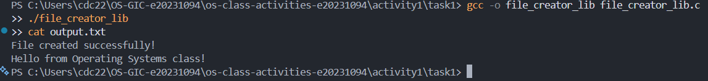

**Version B — POSIX System Calls (`file_creator_sys.c`):**

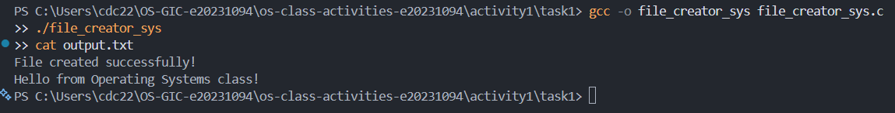

**Questions:**

1. **What flags did you pass to `open()`? What does each flag mean?**

   > I used `O_WRONLY | O_CREAT | O_TRUNC`, combined with the bitwise OR operator.
   > - `O_WRONLY` — open the file for writing only (I never read from it).
   > - `O_CREAT` — create the file if it does not exist yet (this is why a third argument, the permissions, is needed).
   > - `O_TRUNC` — if the file already exists, cut its length to 0 so old content is erased and the new text replaces it instead of being mixed with it.
   >
   > Together these three flags are exactly what `fopen(..., "w")` means.

2. **What is `0644`? What does each digit represent?**

   > `0644` is a permission mode written in **octal** (the leading `0` means octal in C). The three digits after it are owner, group and others, and each digit is the sum of read = 4, write = 2, execute = 1:
   > - `6` (4+2) → **owner**: read + write (`rw-`)
   > - `4` → **group**: read only (`r--`)
   > - `4` → **others**: read only (`r--`)
   >
   > It is the same as `-rw-r--r--` in `ls -l`. The mode is only used when the file is newly created, and the kernel removes any bits set in the process `umask` (typically `022`).

3. **What does `fopen("output.txt", "w")` do internally that you had to do manually?**

   > `fopen` translates the mode string `"w"` into the flags `O_WRONLY|O_CREAT|O_TRUNC` and calls `open()` itself (with mode `0666`, which the `umask` turns into `0644`; `strace` shows `0666`). It also allocates and returns a `FILE` structure, and allocates a user-space buffer for it (the extra `brk` and `fstat` calls in `strace` come from this). `fprintf` formats text into that buffer rather than writing right away, and `fclose` flushes the buffer with a single `write()` and then calls `close()`. With raw system calls I had to choose the flags and permissions, pass the byte count, call `write()` and `close()` myself, and check for errors myself.

### Part B — File Reader & Display

**Describe your implementation:** `file_reader_sys.c` opens `output.txt` with `O_RDONLY`, then loops on `read(fd, buffer, 256)`. Every chunk that comes back is sent straight to the terminal with `write(1, buffer, bytesRead)`, and I write exactly `bytesRead` bytes (not `sizeof(buffer)`) so no garbage is printed. The loop ends when `read()` returns `0`, and then I `close(fd)`. The output matches `file_reader_lib` exactly.

**Version A — Library Functions (`file_reader_lib.c`):**

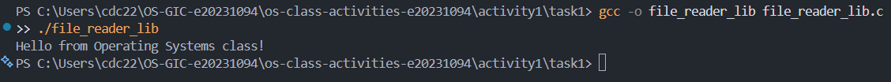

**Version B — POSIX System Calls (`file_reader_sys.c`):**

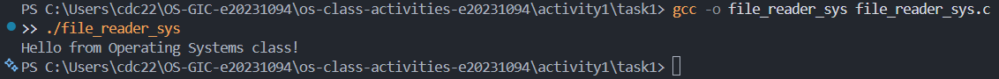

**Questions:**

1. **What does `read()` return? How is this different from `fgets()`?**

   > `read()` returns the **number of bytes actually read**, `0` at end of file, or `-1` on error. It is raw and unformatted: it copies bytes with no regard for lines, may return fewer bytes than requested, and does **not** add a `'\0'` terminator. `fgets()` is a library function that works line by line: it reads up to a newline (or `size-1` characters), appends `'\0'`, and returns a pointer to the buffer, or `NULL` at EOF/error. Internally `fgets` is built on top of `read()` plus buffering.

2. **Why do you need a loop when using `read()`? When does it stop?**

   > One call to `read()` returns at most `count` bytes (256 in my program), and a file may be bigger than the buffer. `read()` can also return fewer bytes than requested, so you cannot assume one call gets everything. The file offset advances after each call, so repeating the call walks through the file. The loop stops when `read()` returns `0` (end of file); a `-1` would indicate an error. In the `strace` of my version you can see `read(3, ..., 256) = 36` followed by `read(3, "", 256) = 0`.

---

## Task 2: Directory Listing & File Info

**Describe your implementation:** `dir_list_sys.c` keeps `opendir`, `readdir` and `stat` (thin wrappers over kernel calls) but replaces every `printf` with `snprintf` into a 512-byte buffer followed by `write(1, buffer, len)`. I used the return value of `snprintf` as the length, so no `strlen` is needed. `readdir()` returns entries in **no guaranteed order**, so I compare the two programs after piping through `sort`; the lines are identical.

### Version A — Library Functions (`dir_list_lib.c`)

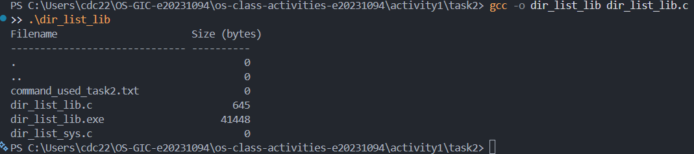

### Version B — System Calls (`dir_list_sys.c`)

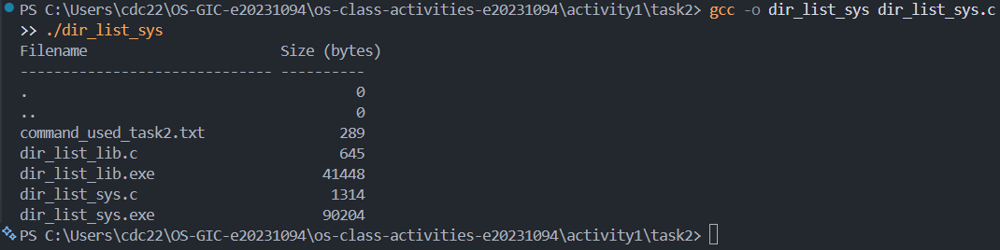

### Questions

1. **What struct does `readdir()` return? What fields does it contain?**

   > It returns a pointer to a `struct dirent` (or `NULL` at the end of the directory). On Linux its fields are `d_ino` (inode number), `d_off` (offset to the next entry), `d_reclen` (length of this record), `d_type` (file type such as regular file or directory) and `d_name[256]` (the null-terminated file name). The only field the portable POSIX standard guarantees is `d_name` (and `d_ino`).

2. **What information does `stat()` provide beyond file size?**

   > `stat()` fills a `struct stat` with: `st_mode` (file type + permission bits), `st_ino` (inode number), `st_dev` (device containing the file), `st_nlink` (number of hard links), `st_uid` / `st_gid` (owner and group), `st_rdev` (device ID for special files), `st_blksize` and `st_blocks` (I/O block size and number of 512-byte blocks allocated), and the timestamps `st_atime` (last access), `st_mtime` (last modification) and `st_ctime` (last status change).

3. **Why can't you `write()` a number directly — why do you need `snprintf()` first?**

   > `write()` sends raw **bytes**, not text. An integer such as `4096` is stored in memory as a binary value (4 or 8 bytes), so `write(1, &size, ...)` would put those binary bytes on the screen and show garbage instead of the characters `'4' '0' '9' '6'`. `snprintf()` converts the number to its ASCII digits, adds padding and alignment (`%-30s %10ld`), and gives the length to pass to `write()`. It also protects against overflowing the buffer.

---

## Optional Bonus: Windows API (`file_creator_win.c`)

Screenshot of running on Windows:

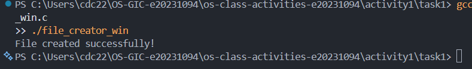

### Bonus Questions

1. **Why does Windows use `HANDLE` instead of integer file descriptors?**

   > A `HANDLE` is an opaque reference to a kernel object. Windows uses it for files, but also for processes, threads, events, mutexes, pipes, registry keys and more, so one uniform type represents all objects and each handle carries its own access rights and security checks. POSIX file descriptors are small integers that index a per-process table of open files, and the "everything is a file" design means they are used mostly for file-like objects. The program should treat a `HANDLE` as a black box and never rely on its numeric value.

2. **What is the Windows equivalent of POSIX `fork()`? Why is it different?**

   > The closest is `CreateProcess()`. `fork()` clones the calling process (copy of its memory, same program) and a separate `exec()` then loads a new program. `CreateProcess()` creates a brand-new process and loads the specified program in a single step, with no copy of the parent. It reflects Windows' design: processes are created fresh from an image, which is simpler to secure and does not need copy-on-write duplication of the parent's address space.

3. **Can you use POSIX calls on Windows?**

   > Yes, indirectly. **WSL** (Windows Subsystem for Linux) runs a real Linux environment (WSL 2 uses a real Linux kernel in a lightweight VM), so Linux system calls work as on Linux. **Cygwin** provides a POSIX compatibility library (`cygwin1.dll`) that translates POSIX calls into WinAPI calls. MinGW offers some POSIX-like C functions but is not full POSIX. Native Windows itself does not implement POSIX system calls.

---

## Task 3: strace Analysis

**Describe what you observed:** The big surprise is that even my "system call" program loads `libc.so.6` — the `open`/`write`/`close` I call are thin glibc wrappers around the real system-call instruction, so the dynamic loader's `openat`, `mmap`, `mprotect` and so on appear in **both** traces. The difference is in what the library adds *on top*: the library version of the file creator made **39** system calls versus **33** for the syscall version (6 more), and in the filtered trace the library version asks for mode `0666` while mine asks for `0644`.

### strace Output — Library Version (File Creator)

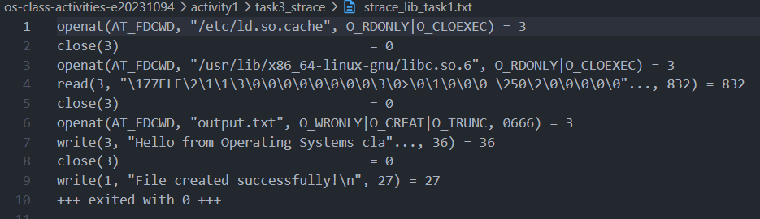

### strace Output — System Call Version (File Creator)

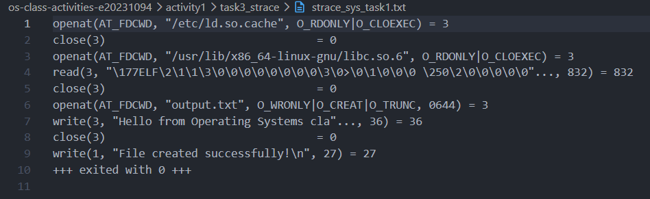

### strace Output — Library Version (File Reader)

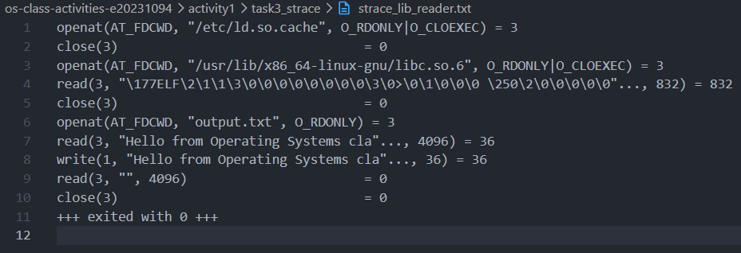

### strace Output — System Call Version (File Reader)

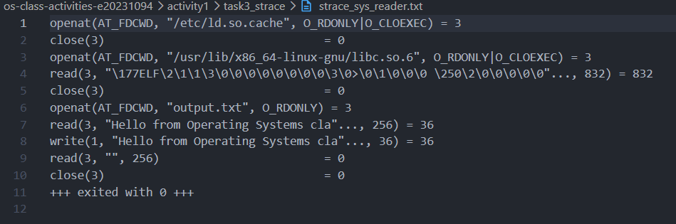

### strace -c Summary Comparison

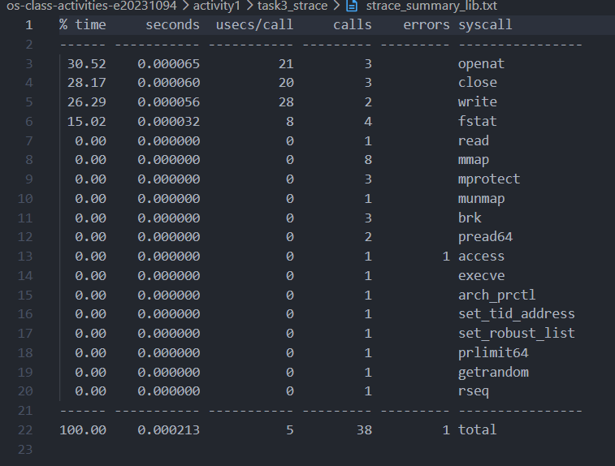
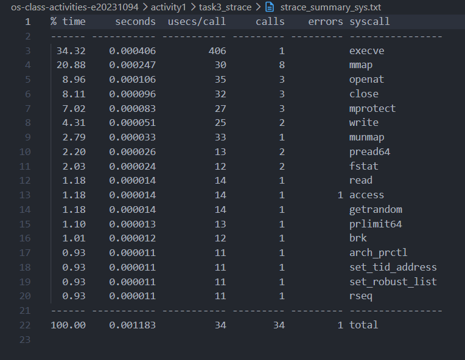

### Questions

1. **How many system calls does the library version make compared to the system call version?**

   > From `strace -c`: the library version (`file_creator_lib`) made **39** calls (2 errors), and the system call version (`file_creator_sys`) made **33** calls (1 error). That is 6 extra calls for the library version, even though both do the same work.

2. **What extra system calls appear in the library version? What do they do?**

   > Comparing the two `strace -c` tables, the library version has these extra calls:
   > - `brk` (3 vs 1, **+2**) — grows the heap; `fopen` uses `malloc` to allocate the `FILE` structure and its I/O buffer.
   > - `fstat` (4 vs 2, **+2**) — one on the new file and one on stdout, so stdio can learn the file type and block size and choose its buffering strategy (full buffering for files, line buffering for a terminal).
   > - `ioctl` (**+1**, `TCGETS`, returns `ENOTTY`) — stdio asks "is stdout a terminal?" to decide on line vs. full buffering.
   > - `getrandom` (**+1**) — glibc's `malloc` initialization asks the kernel for random bytes.
   >
   > The calls that appear in **both** (`execve`, `mmap`, `mprotect`, `openat` of `ld.so.cache` and `libc.so.6`, `access`, `pread64`, `arch_prctl`, `set_tid_address`, `rseq`, …) belong to program start-up and the dynamic loader, not to my code.

3. **How many `write()` calls does `fprintf()` actually produce?**

   > Just **one**: `write(3, "Hello from Operating Systems cla"..., 36) = 36`. I expected the text to be written when `fprintf()` ran, but the library buffers it in user space and only writes it when `fclose()` flushes the buffer. A single `fprintf` makes no difference here, but with many small `fprintf`/`printf` calls the library would batch them into few large `write()`s, whereas direct `write()` would issue one system call per call. (The same effect shows in the reader: `fgets`/`fopen` read a 4096-byte chunk with one `read(3, ..., 4096)`, while my version asks for 256 bytes at a time.)

4. **In your own words, what is the real difference between a library function and a system call?**

   > A **system call** is a request to the kernel: the program executes a special instruction (`syscall`) to switch from user mode to kernel mode, and the kernel does the privileged work (touching files, memory, devices). It is the only door into the kernel, and each crossing is relatively expensive. A **library function** is ordinary code that runs in user space and is linked into my program. Some library functions (like `strlen`) never call the kernel at all; others (like `fopen`/`printf`) add formatting, buffering and error handling on top and eventually call one or more system calls. Even `open()` and `write()` in C are small libc wrapper functions around the real system call. `strace` shows this: the library version produced extra calls (`brk`, `fstat`, `ioctl`) that my code never asked for, while the file contents were written in a single `write()` either way.

---

## Task 4: Exploring OS Structure

> Replace the `[...]` values below with what **your own** machine shows (run `bash run_all.sh`; it saves everything to `task4/`).

### System Information

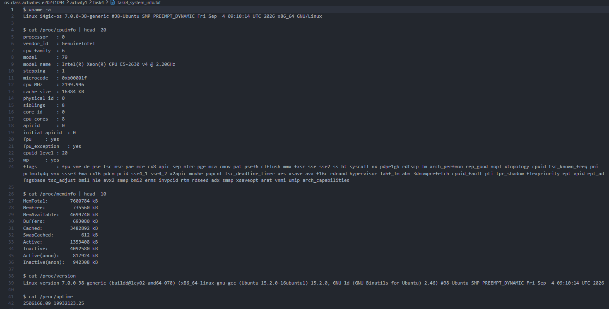

### Process Information

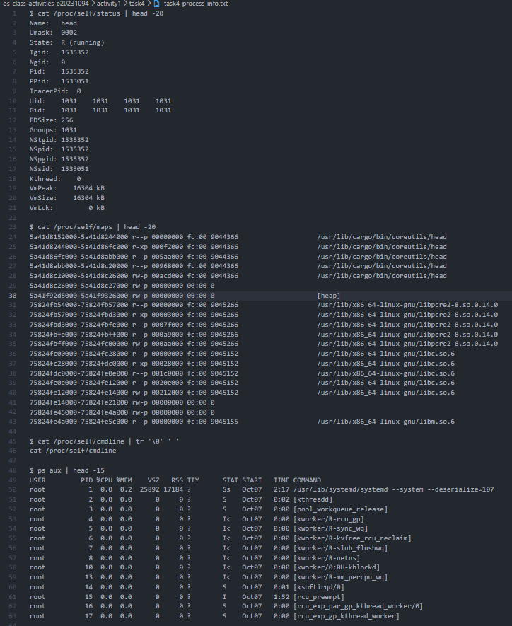

### Kernel Modules

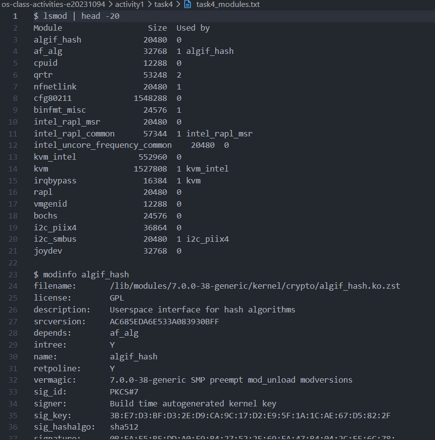

### OS Layers Diagram

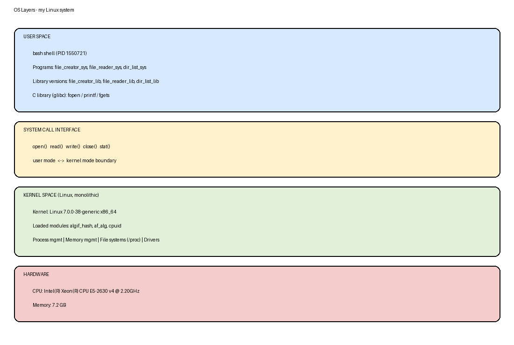

### Questions

1. **What is `/proc`? Is it a real filesystem on disk?**

   > `/proc` is a **virtual** (pseudo) filesystem called `procfs`. It is **not** stored on disk. The files exist only in memory, and the kernel generates their contents on the fly each time you read them (which is why most files show size `0` in `ls -l`). Its data comes straight from the kernel's internal data structures: CPU info, memory counters, per-process details (`/proc/<PID>/`), uptime, loaded modules, and so on.

2. **Monolithic kernel vs. microkernel — which type does Linux use?**

   > In a **monolithic kernel**, all core services (scheduler, memory management, file systems, device drivers, networking) run together in kernel space in one big program, so calls between them are fast function calls but a bug in a driver can crash the whole system. In a **microkernel**, only the bare minimum (IPC, basic scheduling, memory addressing) is in the kernel, and the other services (drivers, file systems) run as separate user-space servers that talk by message passing, which is more isolated and secure but slower. **Linux is monolithic**, but it is *modular*: `lsmod` shows modules such as [module names from your `lsmod`] that were loaded into the running kernel and run in kernel mode, in the same address space as the rest of the kernel, instead of as separate user processes.

3. **What memory regions do you see in `/proc/self/maps`?**

   > - **Program code and data** — mappings of `/usr/bin/cat`: `r-xp` (executable code), `r--p` (read-only data) and `rw-p` (writable globals).
   > - **`[heap]`** — memory for dynamic allocation (`malloc`), growing via `brk`.
   > - **Shared libraries** — several mappings of `libc.so.6` (code, read-only data, writable data) and of the dynamic loader `ld-linux-x86-64.so.2`.
   > - **Anonymous mappings** — `rw-p` with no file name (allocated with `mmap`).
   > - **`[vvar]` and `[vdso]`** — kernel-provided pages that let some calls (like getting the time) run without a full system call.
   > - **`[stack]`** — the process stack, near the top of the address space (it appears at the end of the full map).
   >
   > The `rwxp` letters give the permissions (read/write/execute) and `p` means private.

4. **Break down the kernel version string from `uname -a`.**

   > Pattern: `Linux <hostname> <release> #<build> <flags> <date> <machine> <processor> <platform> GNU/Linux`. For example, `Linux vm 6.18.44-fc-v233 #1 SMP PREEMPT_DYNAMIC @0 x86_64 x86_64 x86_64 GNU/Linux` means:
   > - `Linux` — kernel name.
   > - `vm` — hostname of the machine.
   > - `6.18.44-fc-v233` — kernel release: major `6`, minor `18`, patch `44`, followed by a distribution/build suffix (on Ubuntu this looks like `5.15.0-91-generic`).
   > - `#1` — build number of this kernel build.
   > - `SMP` — supports symmetric multiprocessing (several CPU cores).
   > - `PREEMPT_DYNAMIC` — the kernel's preemption model; the build date/time normally follows.
   > - `x86_64 x86_64 x86_64` — machine hardware, processor and hardware platform (64-bit x86).
   > - `GNU/Linux` — the operating system (GNU tools on the Linux kernel).
   >
   > **[Replace with the values from your own `uname -a`.]**

5. **How does `/proc` show that the OS is an intermediary between programs and hardware?**

   > A normal program cannot read CPU registers, physical memory counters or other processes' internals directly. Instead it uses the ordinary `open()`/`read()` system calls on files such as `/proc/cpuinfo` or `/proc/meminfo`; the kernel collects the data from the hardware and its own data structures and hands it back as text. The program never touches the hardware itself — the kernel decides what is exposed and enforces permissions (for example, you can read your own `/proc/self/` freely, but other users' process details are restricted). This is the same pattern as `write(1, ...)` reaching the screen through the kernel, and it shows the OS as the layer that controls, protects and simplifies access to the hardware.

---

## Reflection

> *(Write this in your own words. A starting point you can adapt:)*
>
> Before this activity I treated `printf` and `fopen` as "the way you do I/O". Tracing them showed me that they are convenience layers over a very small set of kernel requests. The most surprising thing was how much extra work the library does behind the scenes — heap allocation, `fstat`, checking whether stdout is a terminal, buffering — and that my "pure system call" program still loads `libc`, because `open()` and `write()` are themselves libc wrappers. I also learned why buffering matters: one `fprintf` turned into a single `write()` at `fclose()`. Finally, `/proc` showed me that the kernel exposes its internal state through the same file interface (`open`/`read`), which makes the "everything is a file" idea concrete.
