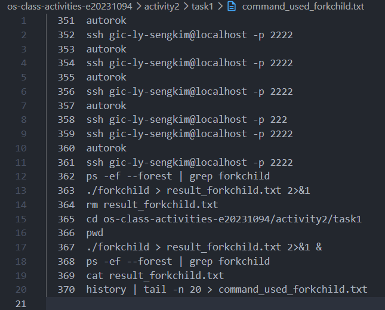
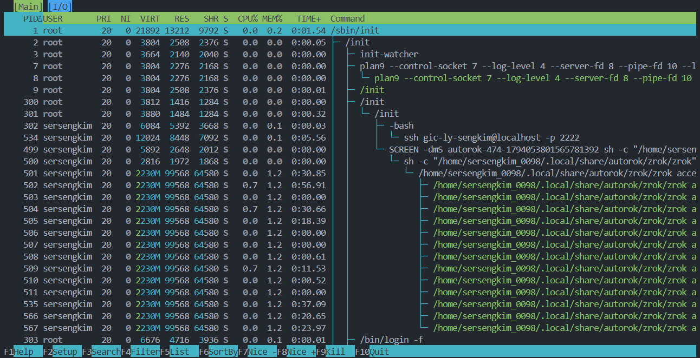
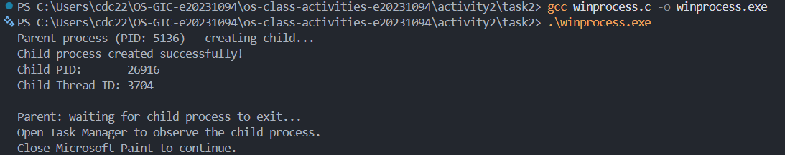
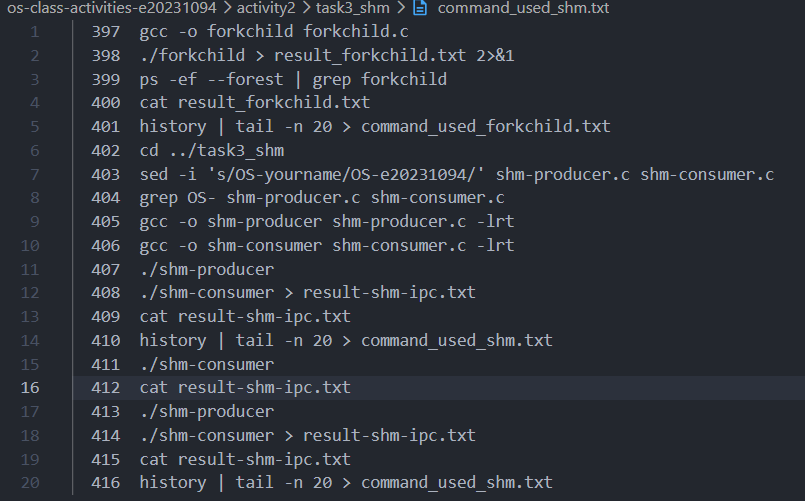
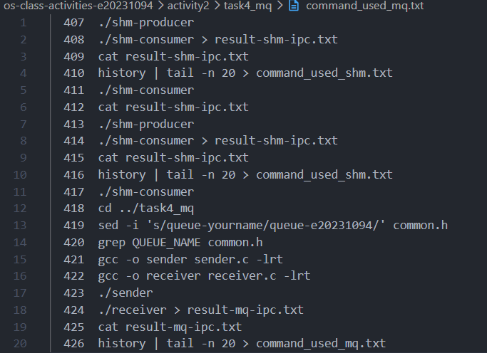

# Class Activity 2 — Processes & Inter-Process Communication

- **Student Name:** [LY SENGKIM]
- **Student ID:** [e20231094]
- **Date:** [7/11/2026]

---

## Task 1: Process Creation on Linux (fork + exec)

### Compilation & Execution


### Process Tree


### Output
```
[Paste the content of result_forkchild.txt here]
```

### Questions

1. **What does `fork()` return to the parent? What does it return to the child?**

   > `fork()` returns the child's PID (a positive integer) to the parent, and `0` to the child. It returns `-1` to the parent if it fails (no child is created). This difference is how the same code can tell which process is running which branch of the `if/else`.

2. **What happens if you remove the `waitpid()` call? Why might the output look different?**

   > The parent no longer blocks, so it prints "done" and may exit before the child finishes its 30-second sleep and runs `ls`. The shell prompt returns immediately, and the child's output appears later, mixed into the prompt. The child is briefly an orphan and is adopted by `init`/`systemd` (PPID becomes 1). If the parent kept running without waiting, the finished child would become a zombie until reaped. The parent also loses the child's exit status.

3. **What does `execlp()` do? Why don't we see "execlp failed" when it succeeds?**

   > `execlp()` searches `PATH` for `ls` and replaces the current process image (code, data, heap, stack) with the `ls` program. The PID stays the same, but the old program no longer exists. On success, `execlp()` never returns, because the code after it has been overwritten. Only if it fails does execution continue to `perror("execlp")`.

4. **Draw the process tree for your program (parent → child). Include PIDs from your output.**

   > ```
   > bash (PID ____)
   >  └── forkchild (PID ____)        <- parent
   >       └── forkchild (PID ____)    <- child (PPID = parent PID); becomes "ls" after exec
   > ```
   > *(Fill in the PIDs from your result_forkchild.txt.)*

5. **Which command did you use to view the process tree? What information does each column show?**

   > I used `ps -ef --forest | grep forkchild`. Columns: **UID** (owner), **PID** (process ID), **PPID** (parent's PID — the child's PPID equals the parent's PID), **C** (CPU usage), **STIME** (start time), **TTY** (controlling terminal), **TIME** (CPU time used), **CMD** (command; `\_` marks a child indented under its parent).

---

## Task 2: Process Creation on Windows

### Compilation & Execution


### Task Manager Screenshots


### Questions

1. **What is the key difference between how Linux creates a process (`fork` + `exec`) and how Windows does it (`CreateProcess`)?**

   > Linux uses two steps: `fork()` duplicates the current process, then `exec()` optionally replaces the copy with a new program. Windows does it in one call: `CreateProcess()` creates a new process and loads the named program directly, with no copy of the parent. Windows also returns handles and IDs in a `PROCESS_INFORMATION` structure, instead of just a PID.

2. **What does `WaitForSingleObject()` do? What is its Linux equivalent?**

   > It blocks the calling thread until the given handle is signaled; for a process handle, that means until the process terminates (or the timeout expires; here `INFINITE`). The Linux equivalent is `wait()`/`waitpid()`.

3. **Why do we need to call `CloseHandle()` at the end? What happens if we don't?**

   > `CreateProcess()` opens handles to the child process and its main thread, and the kernel keeps those objects alive until every handle is closed. If we don't close them, we leak handles (kernel object references), and the process's kernel bookkeeping isn't freed even after the child exits. For a short program, Windows cleans up at exit, but in long-running programs the leak accumulates.

4. **In Task Manager, what was the PID of your parent program and the PID of mspaint? Do they match your program's output?**

   > Parent `winprocess.exe` PID: ____ ; mspaint.exe PID: ____ . They match the values printed by the program (`Parent process (PID: ...)` and `Child PID: ...`), and mspaint's Parent PID equals winprocess's PID. *(Fill in your numbers.)*

5. **Compare the Processes tab (tree view) and the Details tab (PID/PPID columns). Which view makes it easier to understand the parent-child relationship? Why?**

   > The Processes tab is easier to read, because nesting shows the hierarchy visually at a glance. The Details tab is more precise and verifiable, because the exact PID and Parent PID numbers show the relationship directly and can be matched against the program's output. Note that Task Manager's Processes tab groups by application, so it may not always reflect the true parent.

---

## Task 3: Shared Memory IPC

### Compilation & Execution


### Output
```
[Paste the content of result-shm-ipc.txt here]
```
Expected:
```
Consumer: reading from shared memory 'OS-yourname'
Consumer: message = "Hello, this is shared memory IPC!"
Consumer: shared memory unlinked.
```

### Questions

1. **What does `shm_open()` do? How is it different from `open()`?**

   > `shm_open()` creates or opens a named POSIX shared memory object and returns a file descriptor. Unlike `open()`, it isn't a regular file on disk: the name (e.g. `OS-yourname`) refers to an object in a memory-backed filesystem (`/dev/shm` on Linux), so any process that knows the name can open it. The descriptor is then sized with `ftruncate()` and mapped with `mmap()`.

2. **What does `mmap()` do? Why is shared memory faster than other IPC methods?**

   > `mmap()` maps the shared memory object into the process's virtual address space and returns a pointer, so the process reads and writes it like ordinary memory. Shared memory is faster because, after setup, data is not copied through the kernel: no system call is needed per transfer, whereas pipes and message queues copy data from user space into the kernel and back out.

3. **Why must the shared memory name match between producer and consumer?**

   > The name is the only way unrelated processes find the same object. A different name would open (or create) a different object, so the consumer would never see the producer's data.

4. **What does `shm_unlink()` do? What would happen if the consumer didn't call it?**

   > It removes the name so no new process can open the object; the memory is freed once all processes have unmapped it. Without it, the object persists in `/dev/shm` after both processes exit (until reboot or manual removal), leaking resources, and a later run would find stale data.

5. **If the consumer runs before the producer, what happens? Try it and describe the error.**

   > `shm_open()` fails because the object doesn't exist yet (the consumer doesn't use `O_CREAT`):
   > ```
   > shm_open: No such file or directory
   > Hint: Did you run shm-producer first?
   > ```
   > The error is `ENOENT`, and the program exits with failure.

---

## Task 4: Message Queue IPC

### Compilation & Execution


### Output
```
[Paste the content of result-mq-ipc.txt here]
```
Expected:
```
Receiver: message received from queue '/queue-yourname'
Receiver: message = "Hello from sender! This is message queue IPC."
Receiver: queue unlinked.
```

### Questions

1. **How is a message queue different from shared memory? When would you use one over the other?**

   > A message queue passes discrete, ordered (FIFO, priority-aware) messages managed by the kernel, with built-in blocking and synchronization; data is copied in and out. Shared memory is a raw region both processes access directly, which is faster but gives no synchronization, so you must add semaphores or mutexes. Use message queues for small, structured messages and simple, safe communication; use shared memory for large data or high-throughput, low-latency sharing.

2. **Why does the queue name in `common.h` need to start with `/`?**

   > POSIX requires portable queue names to begin with a single slash (e.g. `/queue-name`) and contain no further slashes; it identifies the queue in the system-wide queue namespace. Without it, `mq_open()` may fail with `EINVAL` on Linux.

3. **What does `mq_unlink()` do? What happens if neither the sender nor receiver calls it?**

   > It removes the queue's name; the queue is destroyed once all descriptors are closed. If nobody calls it, the queue persists in the kernel after the processes exit (until reboot), keeping stale messages and using system resources (and counting against queue limits).

4. **What happens if you run the receiver before the sender?**

   > `mq_open()` without `O_CREAT` fails with `No such file or directory`, since the queue doesn't exist yet. The program prints the hint and exits. (If the queue already existed but was empty, `mq_receive()` would block until a message arrives.)

5. **Can multiple senders send to the same queue? Can multiple receivers read from the same queue?**

   > Yes to both. Any number of processes can open the same queue and send. Multiple receivers can read too, but each message is delivered to only one receiver (it is removed once read), so receivers compete for messages rather than each getting a copy.

---

## Reflection

> [Write in your own words: what you learned; the most interesting difference between Linux and Windows process creation (e.g. fork+exec vs. the single CreateProcess call); which IPC method you prefer and why.]
