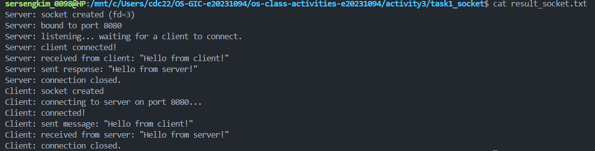
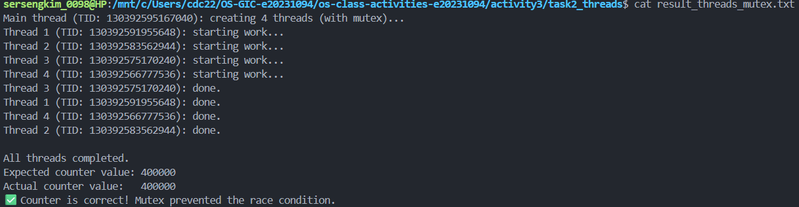
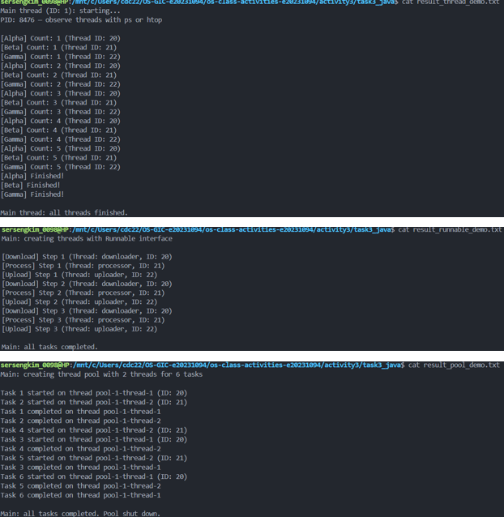
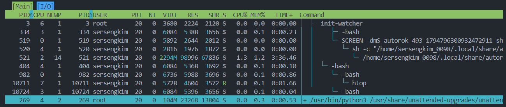
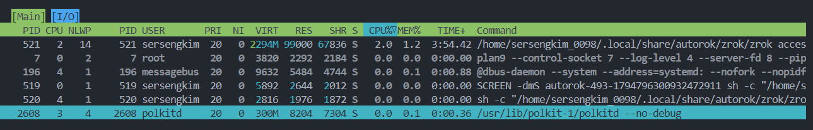
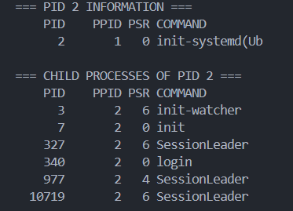
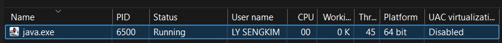

# Class Activity 3 — Socket Communication & Multithreading

- **Student Name:** LY SENGKIM
- **Student ID:** e20231094
- **Date:** 16 November 2026

---

## Task 1: TCP Socket Communication (C)

### Compilation & Execution

The TCP server and client were implemented in C using the POSIX socket API.

The server uses `socket()`, `bind()`, `listen()`, and `accept()` to wait for a client. The client uses `socket()` and `connect()` to connect to the server. They exchange messages using `read()` and `send()`.

**Expected output — Server:**

```text
Server: socket created
Server: bound to port 8080
Server: listening... waiting for a client to connect.
Server: client connected!
Server: received from client: "Hello from client!"
Server: sent response: "Hello from server!"
Server: connection closed.
```

**Expected output — Client:**

```text
Client: socket created
Client: connecting to server on port 8080...
Client: connected!
Client: sent message: "Hello from client!"
Client: received from server: "Hello from server!"
Client: connection closed.
```



### Answers

**1. Role of `bind()` / Why client doesn't call it:**

`bind()` assigns a specific IP address and port number to the server socket. It allows the server to listen for incoming connections at a known address.

The client usually does not need to call `bind()` because the operating system automatically assigns an available local port when it connects to the server.

**2. What `accept()` returns:**

`accept()` returns a new socket file descriptor for communicating with the connected client.

The original server socket continues listening for new connections. The new client socket is used to send and receive data with the connected client.

**3. Starting the client before the server:**

If I start the client before the server, the connection will fail because no server is listening on port 8080.

The client may display:

```text
connect: Connection refused
```

This happens because the server must be running before the client can connect.

**4. What `htons()` does:**

`htons()` means Host To Network Short. It converts a 16-bit number from the computer's byte order into network byte order.

Network byte order uses Big Endian. This conversion ensures that the port number is interpreted correctly when communicating over a network.

**5. Socket call sequence diagram:**

```text
SERVER                         CLIENT
  |                               |
socket()                       socket()
  |                               |
bind()                            |
  |                               |
listen()                          |
  |                           connect()
accept() <------------------------|
  |                               |
read() <---------------------- send()
send() ----------------------> read()
  |                               |
close()                        close()
```

---

## Task 2: POSIX Threads (C)

### Output — Without Mutex (Race Condition)

The program creates four threads. Each thread increments the shared counter 100,000 times.

Expected counter value:

```text
Expected counter value: 400000
```

The actual counter value may be different because multiple threads access and modify the same variable at the same time.



### Output — With Mutex (Correct)

The mutex version uses `pthread_mutex_lock()` and `pthread_mutex_unlock()` to protect the shared counter.

Expected output:

```text
Expected counter value: 400000
Actual counter value:   400000
Counter is correct! Mutex prevented the race condition.
```

### Answers

**1. What is a race condition?**

A race condition happens when multiple threads access and modify shared data at the same time without proper synchronization.

In `threads.c`, all four threads increase `shared_counter`. Some updates may overwrite other updates because the operation is not protected. Therefore, the final result may be incorrect.

**2. What does `pthread_mutex_lock()` do?**

`pthread_mutex_lock()` locks a mutex before a thread accesses shared data.

Only one thread can enter the protected section at a time. Other threads must wait until the mutex is unlocked.

`pthread_mutex_unlock()` releases the lock so another thread can access the shared data. This prevents multiple threads from modifying the counter simultaneously.

**3. Removing `pthread_join()`:**

`pthread_join()` makes the main thread wait until a specific thread finishes its work.

If I remove `pthread_join()`, the main thread may finish before the worker threads complete. The program may terminate before all threads finish, so some work may not be completed.

**4. Thread vs Process:**

A process is an independent program in execution. A thread is a smaller unit of execution inside a process.

Threads in the same process share:
- Code
- Data and global variables
- Heap memory
- Open files

Each thread has its own:
- Stack
- Registers
- Thread ID

Threads are generally lighter and faster to create than separate processes.

---

## Task 3: Java Multithreading

### ThreadDemo Output

The `ThreadDemo` program creates three threads by extending the `Thread` class. Each thread counts from 1 to 5.



### RunnableDemo Output

The `RunnableDemo` program creates three threads using the `Runnable` interface.

The threads perform Download, Process, and Upload tasks. Their output can appear in different orders because they run concurrently.

### PoolDemo Output

The `PoolDemo` program uses an `ExecutorService` with a fixed thread pool of two threads to execute six tasks.

Only two tasks can run at the same time. The remaining tasks wait until a thread becomes available.

### Answers

**1. Thread vs Runnable:**

Extending `Thread` means creating a class that inherits from the `Thread` class and overrides its `run()` method.

Implementing `Runnable` means creating a class that implements the `Runnable` interface and provides a `run()` method. The object is then passed to a `Thread`.

I prefer `Runnable` because Java classes can still extend another class while implementing an interface. It also separates the task from the thread that executes it.

**2. Pool size limiting concurrency:**

In `PoolDemo`, only two tasks run simultaneously because the thread pool has a fixed size of two.

The other four tasks wait in a queue. When one running task finishes, a worker thread takes another task from the queue.

**3. `thread.join()` in Java:**

`thread.join()` makes the current thread wait until the specified thread finishes.

In `ThreadDemo`, the main thread uses `join()` to wait for all three worker threads.

If I remove `join()`, the main thread may continue and finish before the worker threads complete. The worker threads may still run while the main thread has already printed its final message.

**4. ExecutorService advantages:**

`ExecutorService` is useful for managing multiple tasks and threads.

Its advantages include:
- Reusing existing threads.
- Controlling the number of threads.
- Managing task execution with a queue.
- Reducing the cost of creating new threads repeatedly.
- Making multithreaded applications easier to manage.

---

## Task 4: Observing Threads

### Linux — `ps` Thread View

The `ps` command displays information about the threads in the `threads_observe` process.

Example command:

```bash
ps -L -o pid,lwp,nlwp,psr,stat,comm -p PID
```

**Actual output:**

```text
[Paste your actual ps output here]
```

### Linux — htop Thread View

The `htop` tool displays running processes and their threads.

- Press `H` to show or hide user threads.
- Press `F4` to filter by `threads_observe`.
- Press `F5` to display the process tree.
- Press `F2` to configure columns.



### Linux — htop Kernel Threads

Kernel threads are created and managed by the Linux kernel. In the process tree, `kthreadd` has PID 2 and acts as the parent of kernel threads.



### Linux — Kernel Threads (Commands)

Commands used:

```bash
ps -o pid,ppid,psr,comm -p 2

ps --ppid 2 -o pid,ppid,psr,comm | head -15
```

**Actual output:**

```text
[Paste your actual kernel thread command output here]
```



### Windows — Task Manager

Windows Task Manager can display the number of threads used by a Java process.

Steps:
1. Open Task Manager.
2. Select the Details tab.
3. Right-click the column headers.
4. Select Select columns.
5. Enable the Threads column.
6. Find `java.exe` and observe its thread count.



### Answers

**1. LWP column meaning:**

LWP means Light Weight Process. In Linux, it represents the thread ID.

Each thread has a different LWP ID, but threads in the same process share the same process ID (PID).

**2. `/proc/PID/task/` count:**

The `/proc/PID/task/` directory contains one folder for each thread in the process.

For my `threads_observe` program, I expect five entries:
- One main thread.
- Four worker threads.

The expected count is five, including the main thread.

My actual result: **[Write your actual thread count here]**.

**3. Extra Java threads:**

`java.exe` shows more threads than the three threads created in my program because the Java Virtual Machine (JVM) creates its own internal threads.

Examples include:
- Garbage collector threads.
- Just-In-Time (JIT) compiler threads.
- JVM service and management threads.

These threads help the JVM manage memory and execute Java programs.

**4. Linux vs Windows thread viewing:**

Linux provides tools such as `ps`, `/proc`, and `htop` to display detailed thread information, including thread IDs, process IDs, CPU information, and thread counts.

Windows Task Manager displays the total number of threads used by a process in the Threads column.

Linux provides more detailed information about individual threads, while Task Manager provides a simpler overview.

**5. `kthreadd` and three kernel threads:**

`kthreadd` is a Linux kernel process that creates and manages kernel threads. Its PID is always 2.

Examples of kernel threads include:
- `ksoftirqd/0`
- `rcu_sched`
- `kworker/...`

They are kernel threads because they are created and managed by the Linux kernel. They usually appear as children of `kthreadd` in the process tree.

If WSL does not display these threads, this may be due to the environment hiding kernel-level information. It does not mean that the Linux kernel has no kernel threads.

**6. TID equal to PID, NLWP and CPU cores:**

The main thread has a thread ID (TID/LWP) equal to the process ID (PID).

`NLWP` represents the total number of threads in the process. For my program, the expected value is five: one main thread and four worker threads.

`PSR` in `ps` and `PROCESSOR` in `htop` show the CPU core on which a thread last ran.

My observed CPU cores: **[Write the PSR/PROCESSOR values from your actual output here]**.

**7. `H` and `K` in htop:**

- `H` shows or hides user threads belonging to processes.
- `K` shows or hides kernel threads.

Without `H`, I may not see each individual user thread separately. Without `K`, kernel threads may be hidden from the process list.

These keys help me observe both application threads and kernel threads.

---

## Reflection

In this activity, I learned how processes communicate using TCP sockets and how multiple threads execute concurrently.

The most interesting part was observing threads using Linux tools such as `ps`, `/proc`, and `htop`. I also learned that multiple threads can share data, which can cause a race condition if synchronization is not used.

Using a mutex helps protect shared data and produces a correct result. I also learned how Java supports multithreading through `Thread`, `Runnable`, and `ExecutorService`.

Understanding threads at the operating system level helps me write better programs because I can understand how threads are created, scheduled, and managed by the operating system.

---

**Note:** Replace the actual-output placeholders with your own terminal results and add your real screenshots before submitting.