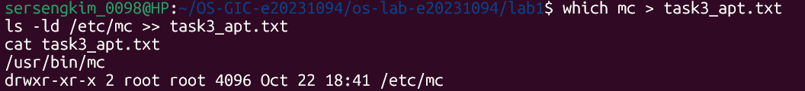
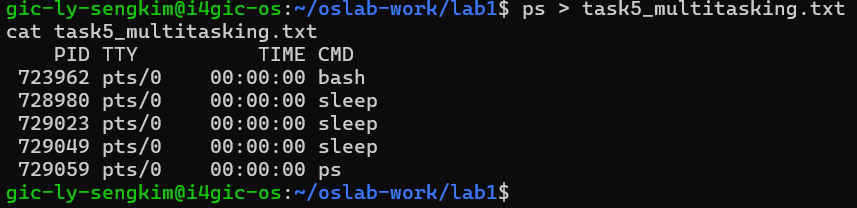
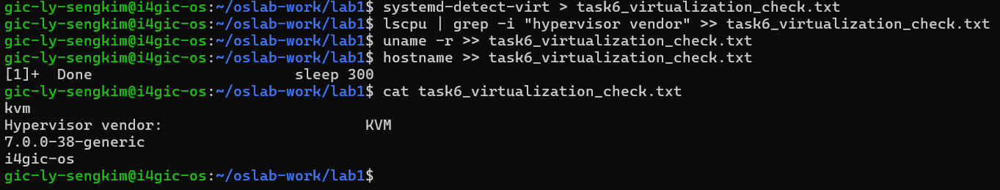

<<<<<<< HEAD
# OS Lab 1 Submission
=======
git add README.md
git commit -m "lab1: update README"
git push# Lab 1
>>>>>>> 9b53ca5c14745a8c1770f6909cd6e3c21361a2ec

* Student Name: LY Sengkim
* Student ID: e20231094
* Ubuntu username on the server: gic-ly-sengkim
* My values (`oslab values lab1`): file1 = panda, file2 = market, count = 3

<<<<<<< HEAD
## Task 1: Operating System Identification
I ran `uname -r` and `lsb_release -a`. The kernel version is [paste from `uname -r`]. The distribution version is [paste from `lsb_release -a`]. The kernel is the core that manages hardware and processes, while the distribution is the complete system built around it, so they are different numbers.

## Task 2: Essential Linux File and Directory Commands
I created `panda` and `market` with `touch`, copied one with `cp`, renamed one with `mv`, and deleted one with `rm`. [Write the exact commands you ran.] The last `ls` showed: [paste your final `ls` output].

## Task 3: Package Management Using APT
`apt remove` uninstalls the package but keeps its configuration files. `apt purge` removes the package and its configuration files. I observed this when [describe what you saw, e.g. a config file remained after remove and was gone after purge].

## Task 4: Programs vs Processes
I ran [e.g. `sleep 100 &`] in the background and found it with [e.g. `ps aux | grep sleep`], where its PID was [PID]. A program is a passive file on disk; a process is a running instance of it, with a PID, memory and state.
* Before: [no sleep process listed]
* During: [sleep line with PID]
* After: [sleep no longer listed]

## Task 5: Multitasking
I started 3 `sleep` commands in the background, and `ps` showed [number you counted] `sleep` lines. This shows the system keeps several processes alive at the same time. It does not show how the processor is shared: whether they run in parallel on several cores or take turns in short time slices, or how the scheduler decides which runs when.

## Task 6: Virtualization and Hypervisor Detection
Based on [commands you ran, e.g. `systemd-detect-virt`, `lscpu`], my system is running on [a virtual machine / physical hardware]. Evidence: [paste the key output].

## My Prediction: Confirmed or Corrected
1. [1st prediction in your words]: [confirmed/corrected]. I saw [evidence].
2. [2nd prediction in your words]: [confirmed/corrected]. I saw [evidence].
3. `apt-get remove`: [confirmed/corrected]. In Task 3 I saw [evidence].

## Plus / Challenge
[Delete this section if you did not do any.]

## AI Note (optional)
An AI tool suggested the README structure and reminded me to fill in observations from my own terminal. I checked by running each command myself and pasting my real output. [Edit or delete to match what you actually did.]
=======
## Tasks completed
- Task 1: OS information (task1_os_info.txt)
- Task 2: File commands (task2_file_commands.txt, task2_files)
- Task 3: apt install mc (task3_apt.txt), done on my own Ubuntu because the server account has no sudo
- Task 4: Process list (task4_process_list.txt)
- Task 5: Multitasking (task5_multitasking.txt)
- Task 6: Virtualization check (task6_virtualization_check.txt)
git add README.md
git commit -m "lab1: update README"
git push# Lab 1

>>>>>>> 9b53ca5c14745a8c1770f6909cd6e3c21361a2ec
